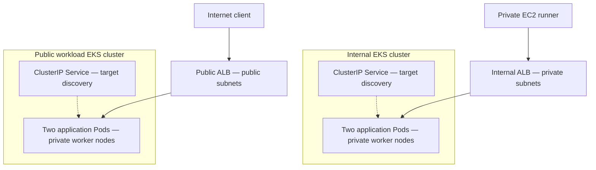
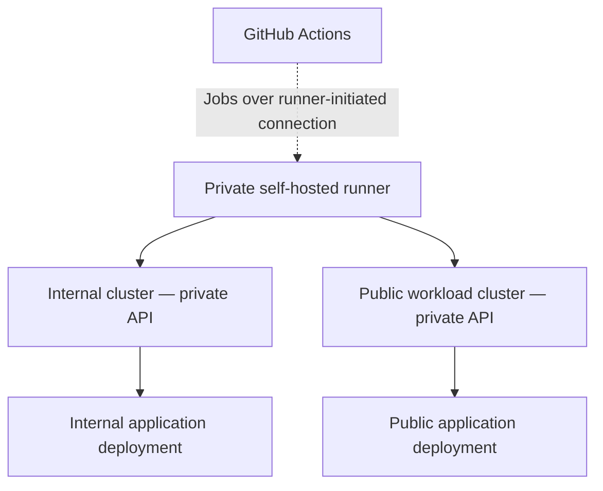

# Architecture

## Application traffic

Both ALBs use IP targets. The controller discovers application
targets through Kubernetes Services and EndpointSlices, then
registers Pod IP addresses in AWS target groups.

Application requests travel from the ALB directly to the Pods.
They do not pass through the Kubernetes API server.

## Deployment and management

The runner initiates outbound HTTPS connections to GitHub through
the NAT Gateway. No inbound SSH or public IP is required on the runner.

Both Kubernetes API endpoints are private. The runner reaches them
through VPC networking and authenticates using its EC2 IAM role.

## Network layout

| Component | Placement |
|---|---|
| VPC | 10.20.0.0/16 in eu-north-1 |
| public_a | 10.20.1.0/24 in eu-north-1a |
| public_b | 10.20.2.0/24 in eu-north-1b |
| private_a | 10.20.11.0/24 in eu-north-1a |
| private_b | 10.20.12.0/24 in eu-north-1b |
| Public ALB | Public subnets |
| Internal ALB | Private subnets |
| EKS worker nodes | Private subnets |
| GitHub Actions runner | private_a |
| NAT Gateway | public_a |

Public subnets have a default route to the Internet Gateway.
Private subnets have a default route to the NAT Gateway.

Traffic between the runner and the internal ALB stays within the VPC.

## Identity

- The runner uses temporary credentials from its EC2 IAM role.
- EKS Access Entries authorize the runner separately in each cluster.
- Application editing is scoped to the default namespace.
- Each Load Balancer Controller uses a dedicated Pod Identity role.
- Controller role trust is restricted by cluster, namespace,
  and service account.
- Temporary cluster administrator grants were removed after installation.

## Validation evidence

Evidence was captured on 2026-11-09:

- [Internal cluster configuration](evidence/internal-cluster.json)
- [Public workload cluster configuration](evidence/public-cluster.json)
- [ALB exposure settings](evidence/load-balancers.json)
- [Running applications](evidence/applications-running.png)
- [Internal deployment workflow](evidence/deploy-internal-success.png)
- [Public deployment workflow](evidence/deploy-public-success.png)
- [Public website](evidence/public-website.png)

The internal application returned HTTP 200 from the runner and
timed out from the external workstation.

The public application returned HTTP 200 from the external workstation.

## Scope and limitations

This is a learning lab, not a production deployment.

- Public application traffic currently uses HTTP.
- Both clusters share network infrastructure and a single NAT Gateway.
- Cross-cluster network isolation was not implemented.
- Worker node IAM roles currently include VPC CNI permissions.
- Terraform state is local.
- Runner setup and Helm installations include manual steps.
- Application images and GitHub Actions use version tags rather than
  immutable digest or commit references.